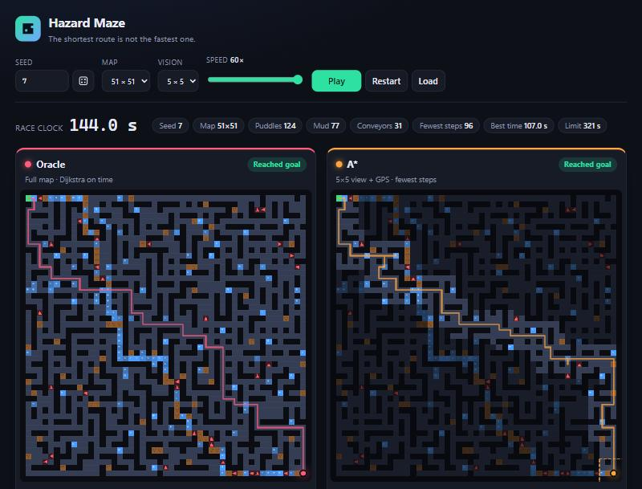

# Hazard Maze

**The shortest route is not the fastest one.**

Agents race through a large grid maze full of game-style hazards. One agent sees the whole map;
the others see only a 5×5 window around themselves plus a GPS that knows the walls but not the
hazards. The question: how close can a limited-vision agent get to the full-map optimum?
This repo is the test bed. The Laya-powered agent plugs in as a fourth racer.



---

## Quick start

Needs **Python 3.10+**. Nothing to install for the simulator and the web viewer.
Pillow is only needed for the optional GIF/PNG export.

```bash
git clone <this repo>
cd hazard-maze
python server.py
```

Open **http://localhost:8000**. All agents race side by side in real time.

| Control | What it does |
|---|---|
| Seed + dice | pick a specific maze or a random one (`N`) |
| Map | 31 × 31 up to 91 × 91 |
| Vision | 3 × 3, 5 × 5 (default), 7 × 7 for the limited agents |
| Speed | simulated seconds per real second |
| Play / Restart | `Space` / `R` |
| Run benchmark | average results over 5–20 mazes |

---

## The rules

Every move takes **1 second**. Score is the **total time** to reach the goal.
The time limit is **3 × the best possible time**.

| Tile | Effect |
|---|---|
| Floor | 1 s per move |
| Wall | blocked; walking into it wastes a move |
| **Puddle** | slip: a one-off **+1 to +3 s** (darker blue = worse) |
| **Mud** | slowed: your **next 3 moves take 2×** as long; stepping in mud again resets the count |
| **Conveyor** | pushes you **one tile back**, away from the goal (+1 s) |
| Goal | reach it to finish |

Every hazard is visible when it is inside your view, and its cost can be worked out from
where you stand. No teleports, no hidden randomness. Hazards only ever add time; there are no shortcuts.
About 40% of puddles and mud are placed on the GPS fewest-steps route, so following the GPS
blindly is punished.

## The agents

| Agent | Sees | Decides by |
|---|---|---|
| **Oracle** | the whole map | Dijkstra on *time*. Its search state is the tile plus how many slowed moves are left. Gives the best possible time: the **ground truth**. |
| **A\*** | 5×5 window + GPS | A\* on *step count*. Understands that a conveyor pushes you, but ignores every time cost. |
| **Obstacle-aware A\*** | 5×5 window + GPS | A\* on *time* using every hazard it has seen (including the mud slowdown), plus the expected hazard cost for tiles it hasn't seen yet. Replans every step. |
| **Laya** | 5×5 window + GPS (same as above) | picks one of 4 moves each step as a classification. Coded separately (see below). |

The GPS knows the wall layout (like a road map) but none of the hazards.

### Results so far (40 mazes, 51 × 51, 5 × 5 vision)

| Agent | Reached goal | Time ÷ best |
|---|---|---|
| Oracle | 100% | **1.00** |
| A\* | 100% | 1.19 |
| Obstacle-aware A\* | 100% | 1.16 |

Knowing the hazards you can see helps only a little. In corridors the window shows just a few
tiles ahead, so a classic planner can't tell whether a detour pays off. The 16–19% gap to the oracle
is what a learned agent (Laya) has to close.

```bash
python maze_sim.py bench --n 40             # reproduce
python maze_sim.py bench --n 40 --radius 1  # 3x3 vision
```

---

## Plugging in Laya

Create `laya_agent.py` next to `server.py` (start from `laya_agent.example.py`):

```python
def predict(state_text: str, obs: dict) -> str:
    """Return "up", "down", "left" or "right"."""
    ...
```

Restart `python server.py`. Laya appears as a fourth panel and in the benchmark.
If it returns an invalid move or walks into a wall, the agent falls back to the GPS move.
(The template's placeholder just follows the GPS, which gets stuck on conveyors. That's expected.)

**What Laya gets each step.** `state_text` is a ready-made sentence, for example:

```
Goal is 45 down, 48 right. GPS says down (93 steps left). Normal speed. Time 9.0s of 375.0s.
Last event: puddle. up: puddle +2s, gps 94, visited 1. down: puddle +1s, gps 92, visited 0.
left: wall. right: wall. View: # # ~2 # . / # # ~2 # . / # # ~2 # # / # # ~1 m . / # # # m #
```

The oracle's answer (the training label) for this state is `down`.

`obs` has the same information as structured data: `neighbors` (tile, delay, conveyor
direction, GPS distance, visit count), `view` (the 5×5 grid of codes), `slowed`, `gps_move`,
`goal_delta`, `time_used` and `time_limit`.

View codes: `#` wall, `.` floor, `~2` puddle +2 s, `m` mud, `^ v < >` conveyor direction, `G` goal.

**Training data.** The label is the oracle's move from the same state. Data is recorded on
the states the limited agents actually visit.

```bash
python maze_sim.py dataset --n 500 --out laya_train.jsonl
```

Each line: `{"text": "...", "obs": {...}, "label": "down"}`. 30 mazes ≈ 6,000 rows.

---

## Command line

```bash
python maze_sim.py demo  --seed 7          # one maze: stats + maze_demo.gif / .png (needs Pillow)
python maze_sim.py bench --n 40            # results table over many mazes
python maze_sim.py dataset --n 500         # Laya training data (JSONL)
python astar_compare.py --n 200 --png      # extra: Dijkstra vs A* when the full map is known
```

Shared flags: `--size 51` (odd), `--seed 7`, `--radius 2` (vision = 2r+1), `--arrows N`
(number of conveyors; scales with the map size by default).

Tuning constants are at the top of `maze_sim.py`: `MUD_SLOW_MOVES`, `SLOW_MULT`, `REDIRECT_COST`,
`TIME_LIMIT_FACTOR`, `PUDDLE_FRAC`, `MUD_FRAC`.

## Project layout

```
maze_sim.py              maze generator, hazards, oracle, A* agents, Laya hook, CLI
server.py                local web server + JSON API (/api/run, /api/bench)
web/                     live viewer (index.html, app.js, style.css): no build step
render.py                GIF/PNG export for the CLI demo (Pillow)
astar_compare.py         extra: full-map Dijkstra vs A* comparison
laya_agent.example.py    template for the Laya agent
docs/viewer.jpg          screenshot
```

## API

| Endpoint | Returns |
|---|---|
| `GET /api/run?seed=7&size=51&radius=2` | the maze (walls, hazards) and each agent's full trace `[row, col, time, event, slowed]` |
| `GET /api/bench?n=10&seed=7&size=51&radius=2` | success rate, average time and time ÷ best per agent |
